<p align="center"></p>

# Hero Meter

A damage meter for City of Heroes (Homecoming), modeled on Details! from World of Warcraft.

It reads your chat log while you play and shows damage, healing, deaths and pet numbers in a small window on top of the game. Out of the box it looks like one of the game's own windows, in your own window color. It's one `.exe` with no installer. It's free, and the code is open source.

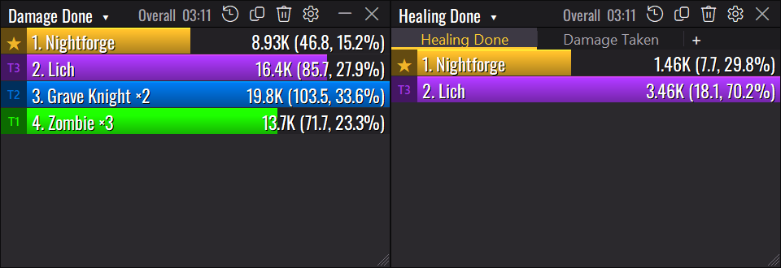

---

## Getting started

1. Download **`HeroMeter.exe`** from the [latest release](../../releases/latest).
2. Put it wherever you like (Desktop, Downloads, a tools folder) and double-click it.
3. In the game, turn on chat logging for each character: **Menu → Options → Windows → Chat → Log Chat**. You can also type `/logchat` once in the chat box.

The meter looks for Homecoming on its own. If the game is running, it reads the install folder from the game itself. If not, it checks the usual install folders on each drive. If it still can't find it, click the meter and point it at your Homecoming folder. It only asks once.

**Windows says "Windows protected your PC"?** That's normal for a new program without a paid signing certificate. Click **More info**, then **Run anyway**. Every release is built by GitHub straight from the code in this repo, and the release page lists the file's SHA-256 checksum so you can check your download.

---

## What it does

### The meter

Fifteen modes: damage done, DPS, damage taken (by enemy or by ability), healing, HPS, healing taken, absorbs, bodyguard protection, kills, accuracy, avoidance, deaths and experience. Each fight is its own segment, plus an Overall total.

Click a bar to see that character's powers. Right-click to go back.

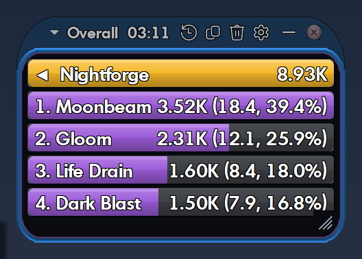

Shift+click a bar for the full breakdown: every power with hits, averages, the biggest hit, accuracy, damage types and targets, plus a DPS-over-time graph of the fight with its peak and average.

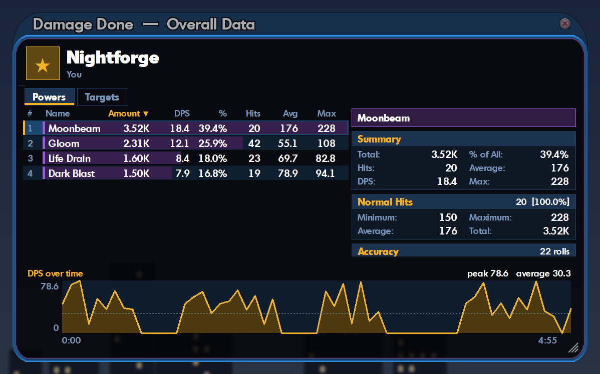

### Masterminds

Hero Meter works out what each of your pets is, even after you rename them, and which tier it belongs to. You can show every pet on its own line, group them by tier, or lump them all together. Right-click a bar to switch.

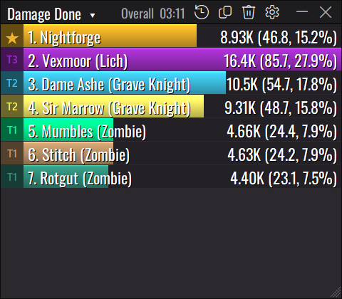

### Death recap

When you die, the recap shows the last few seconds hit by hit: who killed you, with what, how much each enemy did and how long you lasted. It works much like the recap in a MOBA.

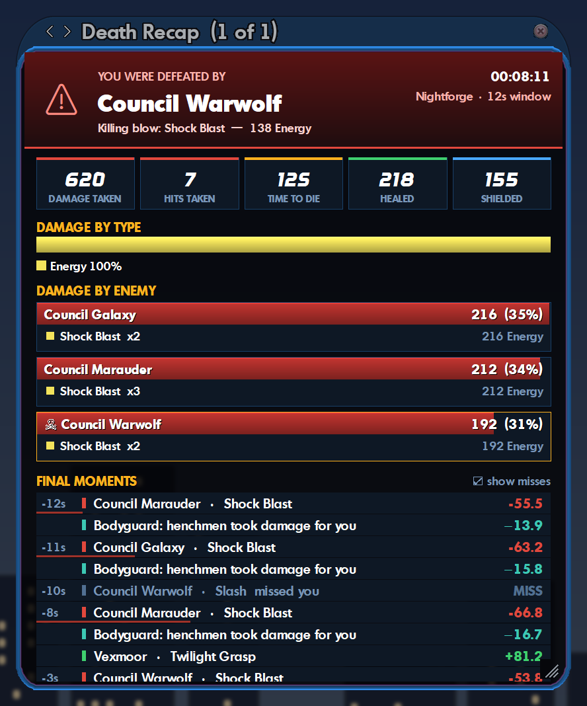

### Alerts

A short pop-up above the meter tells you when you're held, stunned, slept, terrified or confused (and by whom, with what), or when one of your pets is defeated. Immobilize alerts, pet mez alerts and a sound can be switched on in **Options → Alerts**. The pop-up matches the skin you're using.

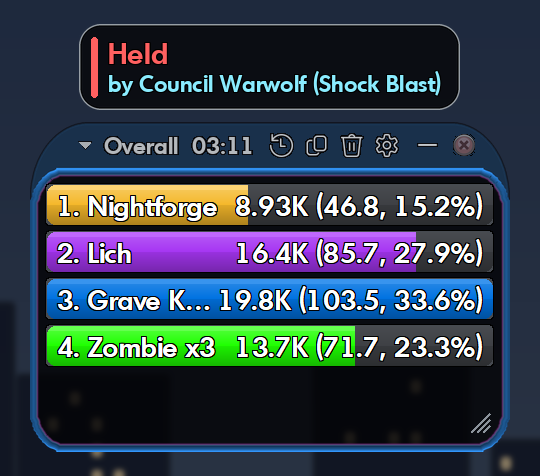

### Personal records

Hero Meter keeps each character's best numbers from fights it saw live: biggest hit, best fight DPS, most damage in one fight, best DPS with your pets, most kills, best healing per second and the longest fight you survived (or just the first three, if you prefer the light list). A pop-up tells you when you beat one. Records live in **Options → Records**, where you can rename a set or **Start fresh** after a respec, and optionally keep separate records for each linked build.

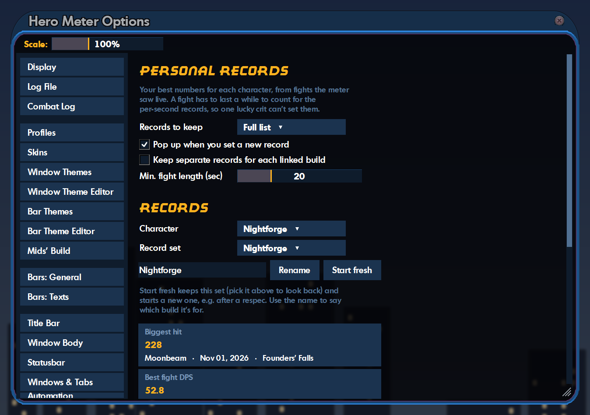

### Make it look how you want

- **Several windows**: open more meters, each showing its own mode and fight. Drag them near each other and they snap together and move as one. Hold Alt while dragging to pull one off.
- **Tabs**: give any window extra tabs so you can flip between modes.
- **Skins** set the shape of every window. **City of Heroes** (the default) copies the game's own windows: the oval title tab, the beveled border, the see-through body, the hover glow, the game's menus and the game's own fonts. **Details!** is the flat, square look of the WoW addon.

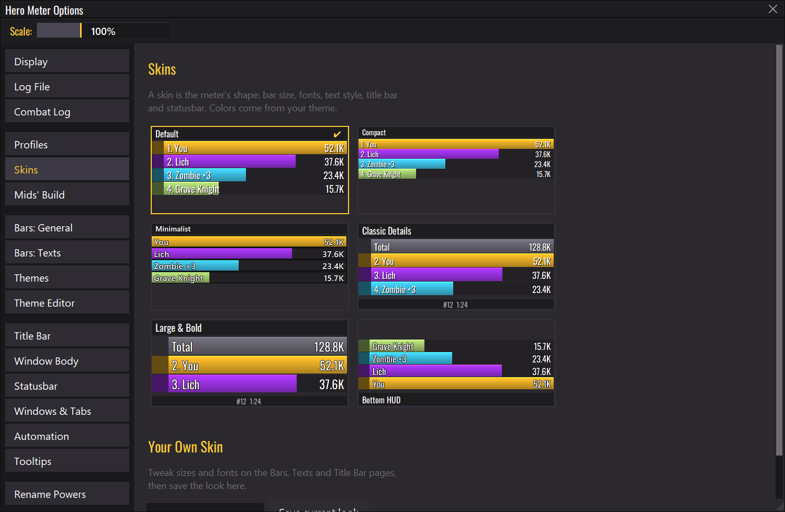

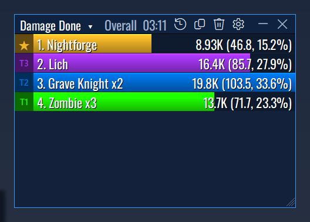

- **Window Themes** are the window colors. Every theme works with every skin, and the Window Theme Editor lets you make your own.
- **Match the game's window color** is on by default. When you log in, the meter reads your character's window color from the game's own window borders and uses it, so each character gets their own color without any typing. Want an exact pick instead? Click **Pick it from a game window** and click the border of any game window.

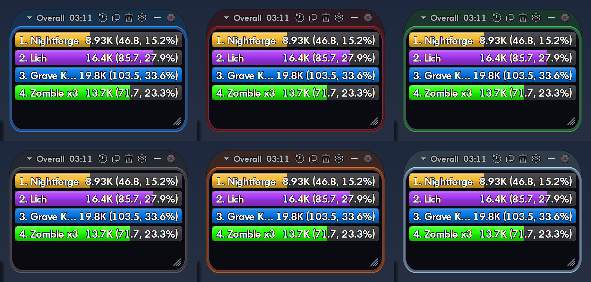

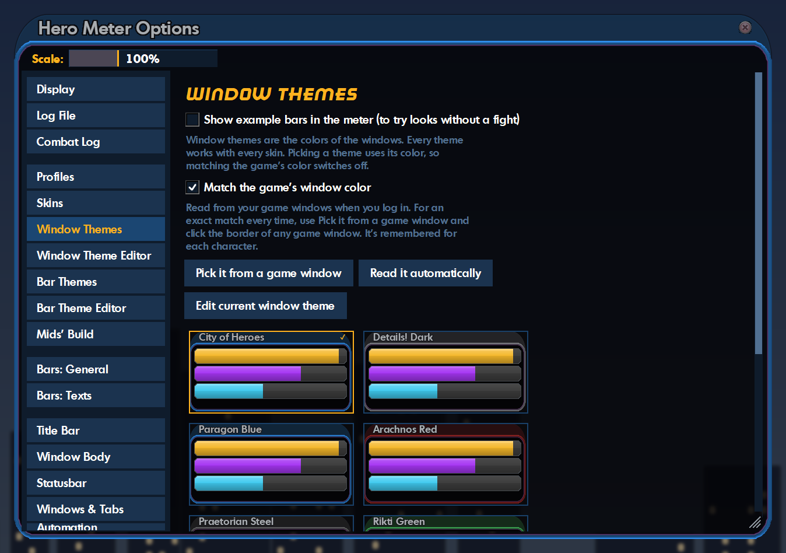

- **Bar Themes** color the bars and text. They also work with every skin, and the Bar Theme Editor lets you change any color, save it as your own theme, and share it with friends by copy and paste.
- **Layout presets** change sizes and fonts in one click. You can also pick any font on your PC or add your own `.ttf` file.
- **Show example bars** fills the meter with sample numbers while Options is open, so you can try looks without a fight.
- **Profiles** save your whole setup, including window layout. You can export and import them, and give each character its own profile so the meter switches when you log in.

### It keeps up with your characters

Hero Meter knows which character you're on. When you go to character select, it goes back to "You" until the next character logs in. If that character doesn't have Log Chat turned on, the meter tells you within a few seconds and gives you the `/logchat` command to paste.

### Your build vs. what you actually do

If you plan builds in **Mids Reborn** or **CoH Sidekick**, link a build to your character. Save it as `CharacterName - anything.mbd` (Mids) or `CharacterName - anything.skif` (Sidekick) and it links itself. Then Hero Meter compares the plan with what you actually do in game:

- **Value Ranking**: which powers do the work, and which ones have a lot of slots for very little output.
- **Planned vs Actual**: every power in the build, what's slotted in it, and whether the log shows you using it.
- **Procs**: whether the procs you slotted are actually firing, and how often.
- **Not in Build**: powers you use that aren't in the build. This usually means a respec, or the wrong build is linked.

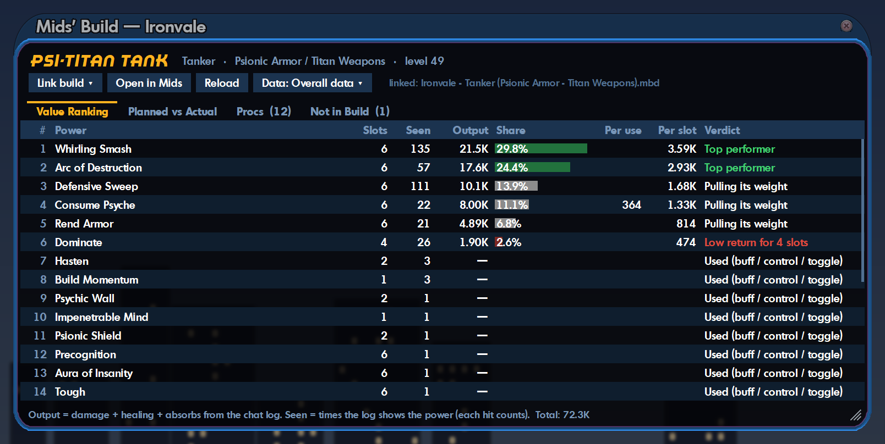

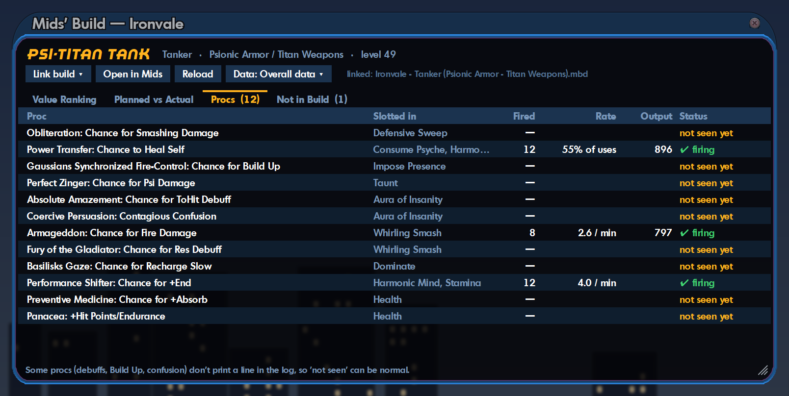

The chat log can only show so much. Passive powers like Health and Stamina never print a line, and neither do some procs (debuffs, Build Up chances). For those, "not seen" doesn't mean anything is wrong.

---

### Chat log clean-up

The game writes a chat log for every day you play and never removes them, so they add up to hundreds of megabytes over time. Hero Meter zips logs older than a week into one archive per month (about 90% smaller, nothing is lost) and deletes archives older than six months. Both ages can be changed in **Options → Log File**, deleting can be set to **Never**, and today's log is never touched. A fresh zip is never deleted in its first two weeks.

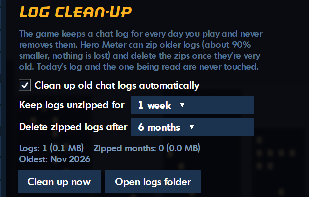

## Privacy

Hero Meter only reads files on your own PC: your chat logs, your account's character list, the game's fonts and your Mids or Sidekick builds. The only files it changes are old chat logs, when Log clean-up zips or removes them. To match your window color it looks at the game window, only while City of Heroes is the window in front, and keeps nothing but the color it found. Nothing gets uploaded. The one thing it does online is check GitHub for a newer version, and you can turn that off under **⚙ → About Hero Meter**.

Settings are saved in `%APPDATA%\Hero Meter`. To keep everything next to the exe instead (handy on a USB stick), put an empty file named `portable.txt` beside `HeroMeter.exe`.

## Found a bug?

Go to **⚙ → About Hero Meter → Copy diagnostics** and paste the result into a [new issue](../../issues/new), along with what happened. Account names are blanked out of the diagnostics automatically.

---

## Building it yourself

You'll need Windows, Python 3.10 or newer, and PyInstaller.

```powershell
pip install pyinstaller
./build.ps1            # makes dist\HeroMeter.exe
python src/meter.py    # or run it straight from the source
```

To release a new version: bump `VERSION` in `src/meter.py`, add a note to `CHANGELOG.md`, then push a tag (`git tag v2.0.1` and `git push --tags`). GitHub builds the exe and publishes the release.

## Credits

- Inspired by **Details! Damage Meter** for World of Warcraft.
- **Oswald** font by Vernon Adams and contributors, under the SIL Open Font License (see `src/fonts/OFL.txt`).
- The City of Heroes skin uses the game's own fonts, read from your Homecoming install. They aren't included with Hero Meter. Until the game is found, a similar Windows font stands in.
- Build data, power names and enhancement names come from your own **Mids Reborn** install, when you have one. Builds from **[CoH Sidekick](https://coh-sidekick.com)** can be linked too.
- The list of oddly named pseudo pets started from the one in **[Cyclops](https://github.com/PaulBenHill/cyclops)** by Paul Benjamin Hill (Apache 2.0).
- The screenshots use made-up demo characters.

## License

GNU General Public License v3.0 (see [`LICENSE`](LICENSE)). You can use, share and change Hero Meter. If you share a modified version, it has to stay open source under the same license.

*Hero Meter is a fan project. It isn't affiliated with or endorsed by Homecoming Servers or NCSoft. City of Heroes is a trademark of NCSoft Corporation.*
