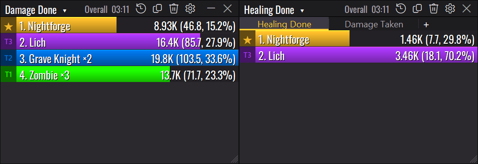

**Hero Meter 2.3** is a free, Details!-style damage meter for City of Heroes Homecoming.

### New in 2.3

- **Procs under the power that fired them** (Options → Breakdown, off by default). Each damage proc is credited
  to the attack that just hit that target, so a breakdown shows, say, **Fire Blast + 1 proc** with the proc counted
  in its total. Click it to see the attack and each proc. Procs nothing set off stay in the Procs row, and
  Interface stays its own line. Thanks to the player on the forums who suggested it!
- **Cleaner Options.** Every page now holds only what its name says: a new **Breakdown** page, **Death Recap** on
  its own, window behavior on **Windows**, **Profiles** under the new **Setup & Data** group, and Alerts split into
  clear sections. No setting changed its value.
- **Fixed:** in the City of Heroes skin, window contents no longer poke over the frame's rounded corners.

### Recently (2.2)

- **Share as a picture** (Report → Copy as a picture), **Earlier days** (Segments → Earlier days…), an
  **Influence** mode with per-hour rates, and **alert sounds**: built-in tones or your own .wav, .ogg or .mp3.

### Get started in three steps

1. Download **`HeroMeter.exe`** below and double-click it. There's no installer.
2. In the game, turn on **Log Chat** for each character: `Menu → Options → Windows → Chat → Log Chat` (or type `/logchat` once).
3. **Using pets, or powers like Rain of Fire or Caltrops?** Right-click a chat tab → **Edit Tab** → add Pet Combat, Pet Damage Inflicted, Pet Damage Received, Pet Hit Rolls, Pet Healing Delivered and Pet Healing Received.

If Windows says **"Windows protected your PC"**, click **More info → Run anyway**. New programs without a paid signing certificate always get that warning. This file was built by GitHub from the code in this repo, and its SHA-256 checksum is in `SHA256.txt` below.

### What it does

- **Sixteen modes:** damage, DPS, healing, damage taken, kills, deaths, accuracy, absorbs, bodyguard, experience, influence and more, for every fight and overall.
- **Masterminds welcome:** every pet on its own bar, grouped by tier, or rolled into yours. Pseudo pets like Rain of Fire count as your damage.
- **Breakdowns:** click a bar for powers, Shift+click for hits, averages, crits and a DPS-over-time graph. Procs can sit under the attack that fired them.
- **Death recap:** the last few seconds before you died, hit by hit.
- **Alerts:** a pop-up and a sound of your choice when you're held, stunned, slept or taunted, or a pet goes down.
- **Personal records** for each character.
- **Your build vs. what you actually do,** from Mids Reborn or CoH Sidekick builds.
- **Looks like the game:** the City of Heroes skin matches each character's own window color, with themes, layouts and profiles if you want something else.
- **Tidy chat logs:** old logs are zipped after a week, and nothing is lost.

New to it? The **[user guide](https://github.com/ForgeSprite/HeroMeter/blob/main/docs/USER_GUIDE.md)** has pictures of every page, and you can open it any time with **⚙ → User Guide**. Hover any setting in Options for a short note on what it does.

### Updating?

Just replace your old `HeroMeter.exe` with this one. Your settings carry over. The full list of changes is in the [changelog](https://github.com/ForgeSprite/HeroMeter/blob/main/CHANGELOG.md).

Found a bug? Click **⚙ → About Hero Meter → Copy diagnostics** and paste it into a [new issue](https://github.com/ForgeSprite/HeroMeter/issues/new).
