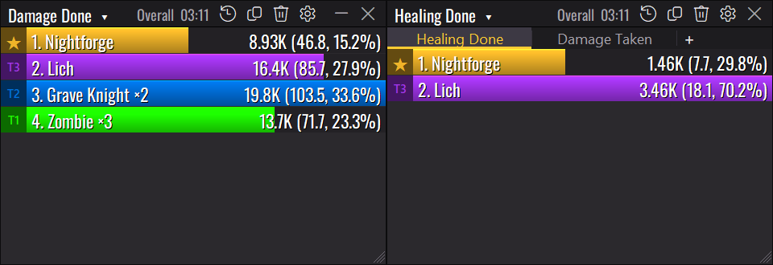

**Hero Meter 2.2** is a free, Details!-style damage meter for City of Heroes Homecoming.

### New in 2.2

- **Share as a picture:** Report → **Copy as a picture** puts a clean image of the meter on your clipboard, with
  your character, the fight and the key totals. Paste it straight into Discord, or **Save as a picture…** for a PNG.
- **Earlier days:** Segments → **Earlier days…** opens any earlier day's fights, deaths and breakdowns, zipped
  logs included. **← Back to today** returns to live play.
- **Influence per hour:** a new Influence mode (Infamy for villains, Information for Praetorians), and Experience
  now shows per hour too.
- **Alert sounds:** the Windows alert, five built-in tones, or your own .wav file (Options → Alerts).
- **Faster Options:** the Window Themes and Skin pages open quickly the first time.
- **Fixed:** the status bar's damage, DPS and kills match what the meter lists, even after switching characters,
  and its right-hand text no longer hides under the resize corner.

### Recent fixes (2.1.1)

- One swing with Rage (or any two-damage-type power) counts as one hit.
- Mez alerts only when the mez actually lands, plus a new taunt alert.
- Minimize while City of Heroes isn't focused (2.1, thanks to **@cmihran**).

### Get started in three steps

1. Download **`HeroMeter.exe`** below and double-click it. There's no installer.
2. In the game, turn on **Log Chat** for each character: `Menu → Options → Windows → Chat → Log Chat` (or type `/logchat` once).
3. **Using pets, or powers like Rain of Fire or Caltrops?** Right-click a chat tab → **Edit Tab** → add Pet Combat, Pet Damage Inflicted, Pet Damage Received, Pet Hit Rolls, Pet Healing Delivered and Pet Healing Received.

If Windows says **"Windows protected your PC"**, click **More info → Run anyway**. New programs without a paid signing certificate always get that warning. This file was built by GitHub from the code in this repo, and its SHA-256 checksum is in `SHA256.txt` below.

### What it does

- **Sixteen modes:** damage, DPS, healing, damage taken, kills, deaths, accuracy, absorbs, bodyguard, experience, influence and more, for every fight and overall.
- **Masterminds welcome:** every pet on its own bar, grouped by tier, or rolled into yours. Pseudo pets like Rain of Fire count as your damage.
- **Breakdowns:** click a bar for powers, Shift+click for hits, averages, crits and a DPS-over-time graph.
- **Death recap:** the last few seconds before you died, hit by hit.
- **Alerts:** a pop-up and a sound of your choice when you're held, stunned, slept or taunted, or a pet goes down.
- **Personal records** for each character.
- **Your build vs. what you actually do,** from Mids Reborn or CoH Sidekick builds.
- **Looks like the game:** the City of Heroes skin matches each character's own window color, with themes, layouts and profiles if you want something else.
- **Tidy chat logs:** old logs are zipped after a week, and nothing is lost.

New to it? The **[user guide](https://github.com/ForgeSprite/HeroMeter/blob/main/docs/USER_GUIDE.md)** has pictures of every page, and you can open it any time with **⚙ → User Guide**. Hover any setting in Options for a short note on what it does.

### Updating?

Just replace your old `HeroMeter.exe` with this one. Your settings carry over. The full list of changes is in the [changelog](https://github.com/ForgeSprite/HeroMeter/blob/main/CHANGELOG.md).

Found a bug? Click **⚙ → About Hero Meter → Copy diagnostics** and paste it into a [new issue](https://github.com/ForgeSprite/HeroMeter/issues/new).
