# Hero Meter user guide

Short answers, with pictures. Jump to what you need.

| I want to... | Go to |
|---|---|
| Set it up for the first time | [Set up in three steps](#set-up-in-three-steps) |
| Know what the buttons do | [The meter at a glance](#the-meter-at-a-glance) |
| See damage, healing, deaths and more | [Everyday use](#everyday-use) |
| Find one setting | [Options](#options) |
| Fix a problem | [Troubleshooting](#troubleshooting) |

You can open this guide from the meter with **⚙ → User Guide**. In Options, the **User Guide ↗** link at the top right opens the section for the page you're on.

---

## Set up in three steps

**1. Run it.** Download `HeroMeter.exe` from the [latest release](https://github.com/ForgeSprite/HeroMeter/releases/latest) and double-click it. There's no installer.

> If Windows says "Windows protected your PC", click **More info**, then **Run anyway**. New programs without a paid certificate always get this warning.

**2. Turn on chat logging.** In the game: **Menu → Options → Windows → Chat → Log Chat**. Or type `/logchat` once. Do it on every character you want to track.

**3. Using pets?** Masterminds, pet classes, and powers like Rain of Fire, Caltrops or Burn need the pet channels in a chat tab, or the game never writes their damage down.

- Right-click a chat tab (Combat is a good choice) and choose **Edit Tab**.
- Add Pet Combat, Pet Damage Inflicted, Pet Damage Received, Pet Hit Rolls, Pet Healing Delivered and Pet Healing Received.
- Once per character. Hero Meter warns you if it notices pet damage is missing.

That's it. The meter finds the game and today's log on its own.

---

## The meter at a glance

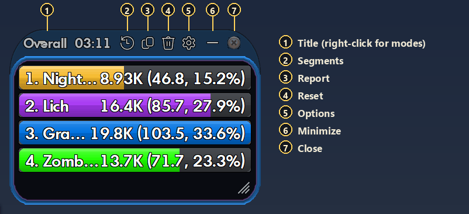

1. The title shows which fight you're looking at. Right-click it to change what the meter shows.
2. Segments: pick a fight, the current fight, or Overall.
3. Report: copy the numbers, ready to paste in game chat.
4. Reset: clear all fights.
5. ⚙ Options, User Guide, profiles and more.
6. Minimize.
7. Close.

Drag the title bar to move the window and the bottom-right corner to resize it.

---

## Everyday use

### See someone's powers

Click a bar to see that character's or pet's powers. Right-click to go back.

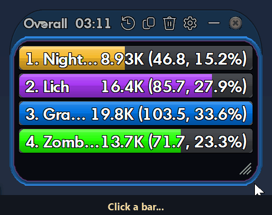

Shift+click a bar for the full breakdown: every power with hits, average, biggest hit, accuracy and targets, plus a DPS-over-time graph.

### Change what the meter shows

Right-click the title and pick a mode.

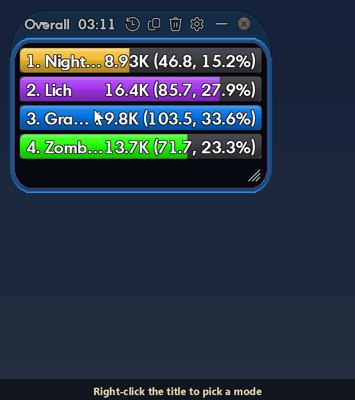

| Group | Modes |
|---|---|
| Damage | Damage Done, DPS, Damage Taken, Enemy Damage Taken, Damage Taken by Ability, Bodyguard Protection, Kills |
| Healing | Healing Done, HPS, Healing Taken, Absorbs Granted |
| Other | Accuracy, Avoidance, Deaths, Experience |

### Fights and Overall

- Every fight is saved as its own segment. A fight ends after 10 seconds of quiet.
- Overall adds up everything since you last pressed Reset.
- Click the Segments button to switch between them.

### When something happens to you

A pop-up above the meter tells you when you're held, stunned, slept, terrified or confused, and by whom. It also tells you when a pet is defeated.

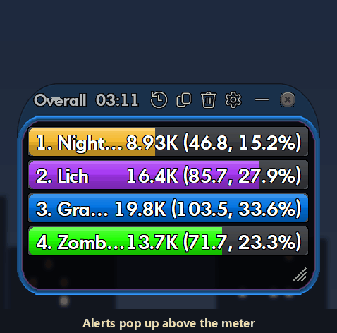

Click it to close it early. You choose which alerts you get on the [Alerts](#alerts) page.

### More handy tricks

- Hover a bar for a tooltip. Hold Shift to see every line.
- Right-click a pet group to open or close it.
- When you die, a death recap shows the last few seconds, hit by hit.
- Want more than one meter? Right-click a title and choose **New window** or **New tab**.

---

## Options

Open it with **⚙ → Options…**. Pages are grouped into Meter, Look, Windows and Data.

Can't find a setting? Type in the search box.

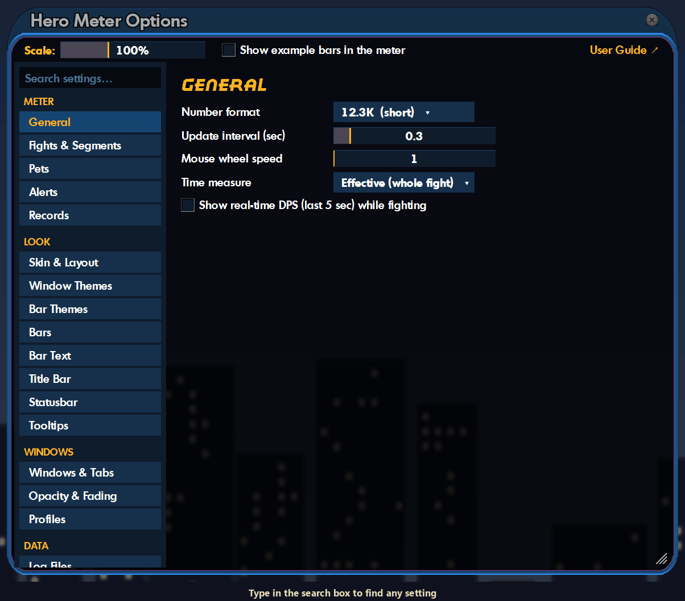

At the top of every page:

- **Scale** makes all of Hero Meter bigger or smaller.
- **Show example bars** fills the meter with sample numbers while Options is open, so you can try a look without a fight.

Each page below has a picture, the things worth knowing, and a table of every setting with its default. Changes apply right away.

 

### General

Numbers, refresh speed and how DPS is counted.

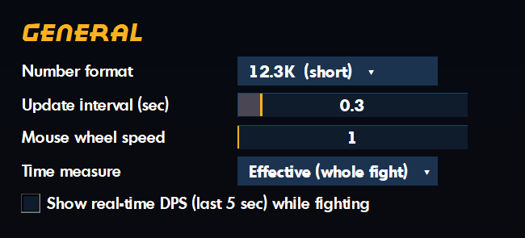

- Effective time divides by the whole fight. Active time only counts the time each character was attacking, which is kinder to people who join late.

All settings and defaults

| Setting | Default |
|---|---|
| Number format | 12.3K (short). Also 12,345 (full) or 12345 (plain) |
| Update interval | 0.3 sec |
| Mouse wheel speed | 1 |
| Time measure | Effective (whole fight) |
| Show real-time DPS (last 5 sec) while fighting | Off |

### Fights and segments

When a fight ends and what's kept.

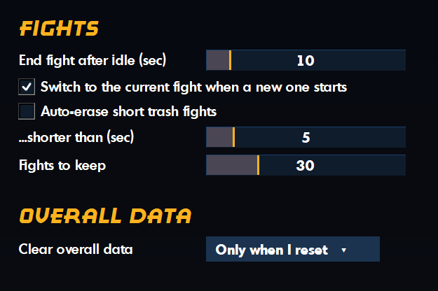

- Turn on **Auto-erase short trash fights** to drop tiny fights from the list.
- Overall only clears when you press Reset, unless you pick zone change or login here.

All settings and defaults

| Setting | Default |
|---|---|
| End fight after idle | 10 sec |
| Switch to the current fight when a new one starts | On |
| Auto-erase short trash fights | Off |
| ...shorter than | 5 sec |
| Fights to keep | 30 |
| Clear overall data | Only when I reset |

### Pets

How pets show up.

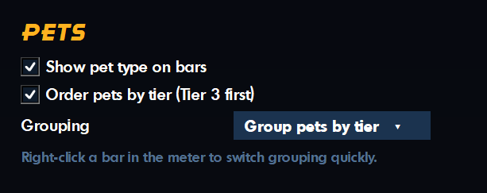

- Grouping can show every pet, group them by tier, lump all pets together, or merge you and your pets into one bar.
- Right-clicking a bar in the meter switches grouping too.

All settings and defaults

| Setting | Default |
|---|---|
| Show pet type on bars | On |
| Order pets by tier (Tier 3 first) | On |
| Grouping | Group pets by tier |

### Alerts

Which pop-ups you get.

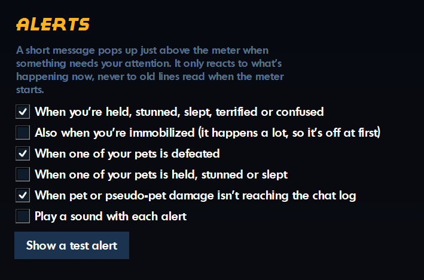

- Immobilize happens a lot, so it starts off.
- The log doesn't say how long an effect lasts, so there are no timers.
- **Show a test alert** shows what one looks like.

All settings and defaults

| Setting | Default |
|---|---|
| When you're held, stunned, slept, terrified or confused | On |
| Also when you're immobilized | Off |
| When one of your pets is defeated | On |
| When one of your pets is held, stunned or slept | Off |
| When pet or pseudo-pet damage isn't reaching the chat log | On |
| Play a sound with each alert | Off |

### Records

Your best numbers for each character, from fights the meter saw live.

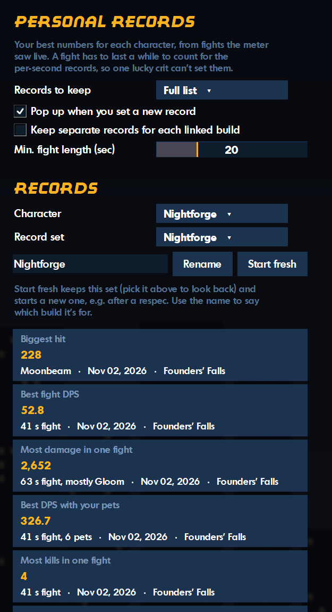

- The full list has seven records: biggest hit, best fight DPS, most damage in one fight, best DPS with pets, most kills, best healing per second and longest fight survived. Light keeps the first three.
- A fight has to last 20 seconds to count for the per-second records, so one lucky crit can't set them.
- Respecced? Click **Start fresh**. The old set is kept, so you can still look back at it.

All settings and defaults

| Setting | Default |
|---|---|
| Records to keep | Full list |
| Pop up when you set a new record | On |
| Keep separate records for each linked build | Off |
| Min. fight length | 20 sec |

### Skin and layout

The shape of every window.

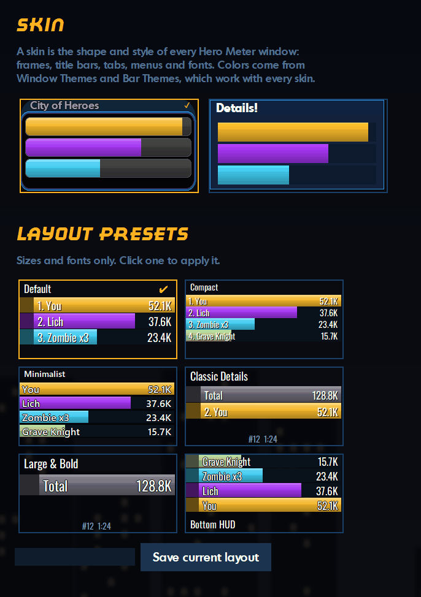

- City of Heroes (the default) looks like the game's own windows. Details! is the flat look of the WoW addon.
- Layout presets change sizes and fonts in one click. **Save current layout** keeps your own.

### Window themes

The colors of the windows.

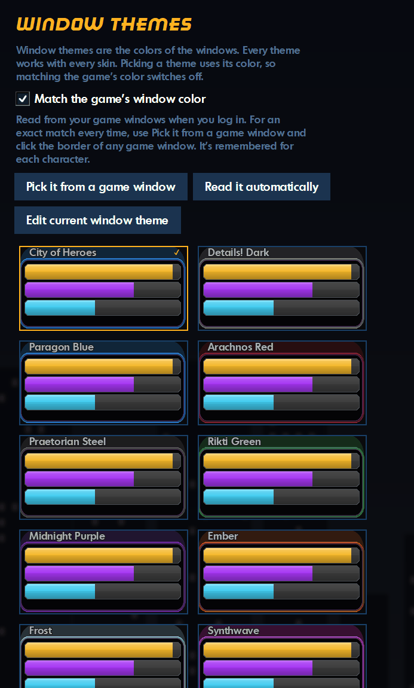

- **Match the game's window color** is on by default. Each character gets its own color from the game.
- Wrong color? Click **Pick it from a game window**, then click the border of any game window.
- Picking a theme by hand turns matching off.

### Bar themes

The colors of the bars.

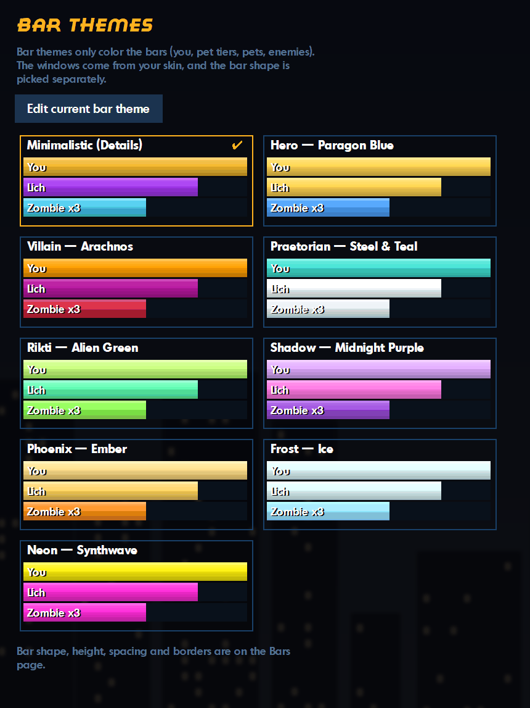

- The default is Minimalistic (Details). Click any theme to try it.
- **Edit current bar theme** lets you change any color and share themes with friends.

### Bars

Size, shape and color of the bars.

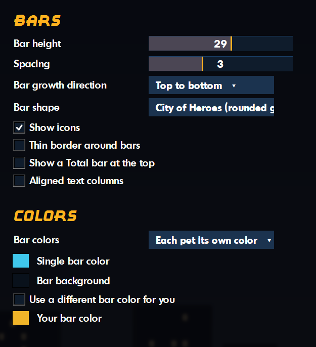

All settings and defaults

| Setting | Default |
|---|---|
| Bar height | Set by your skin (14 to 40) |
| Spacing | Set by your skin (0 to 8) |
| Bar growth direction | Top to bottom |
| Bar shape | City of Heroes (rounded gloss) |
| Show icons | On |
| Thin border around bars | Off |
| Show a Total bar at the top | Off |
| Aligned text columns | Off |
| Bar colors | Each pet its own color |
| Use a different bar color for you | Off |

### Bar text

Font and the numbers on each bar.

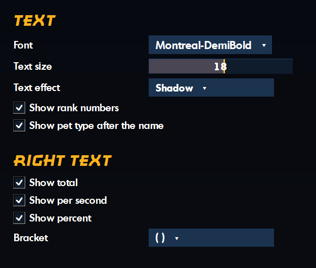

- Use any font on your PC, or add your own `.ttf` file.

All settings and defaults

| Setting | Default |
|---|---|
| Font, size and text effect | Set by your skin |
| Show rank numbers | On |
| Show pet type after the name | On |
| Show total | On |
| Show per second | On |
| Show percent | On |
| Bracket | ( ) |

### Title bar

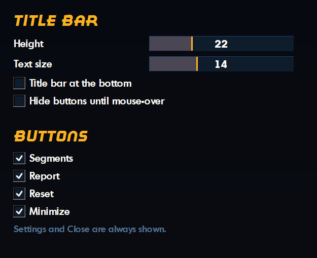

- Hide the buttons you don't use. Options and Close always stay.

All settings and defaults

| Setting | Default |
|---|---|
| Height and text size | Set by your skin |
| Title bar at the bottom | Off |
| Hide buttons until mouse-over | Off |
| Segments, Report, Reset, Minimize buttons | On |

### Statusbar

An optional strip under the bars.

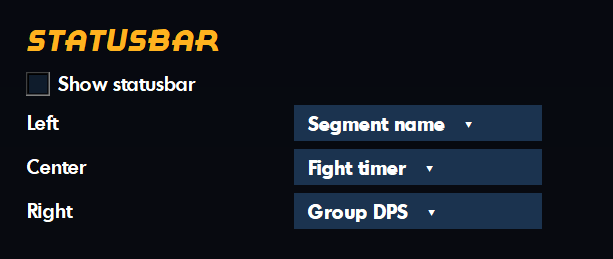

All settings and defaults

| Setting | Default |
|---|---|
| Show statusbar | Off |
| Left | Segment name |
| Center | Fight timer |
| Right | Group DPS |

Each slot can also show your DPS, group damage, deaths, kills or nothing.

### Tooltips

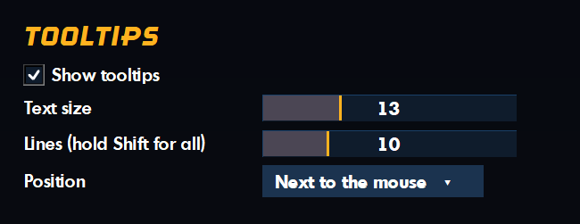

All settings and defaults

| Setting | Default |
|---|---|
| Show tooltips | On |
| Text size | 13 |
| Lines (hold Shift for all) | 10 |
| Position | Next to the mouse |

### Windows and tabs

More meters, each with its own mode and fight.

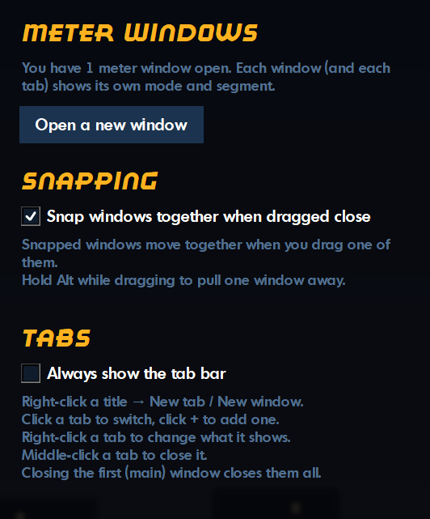

- Drag windows close and they snap together. Hold Alt while dragging to pull one away.
- Click **+** on the tab bar to add a tab. Middle-click a tab to close it.
- Closing the first window closes them all.

### Opacity and fading

See-through, fading and click-through.

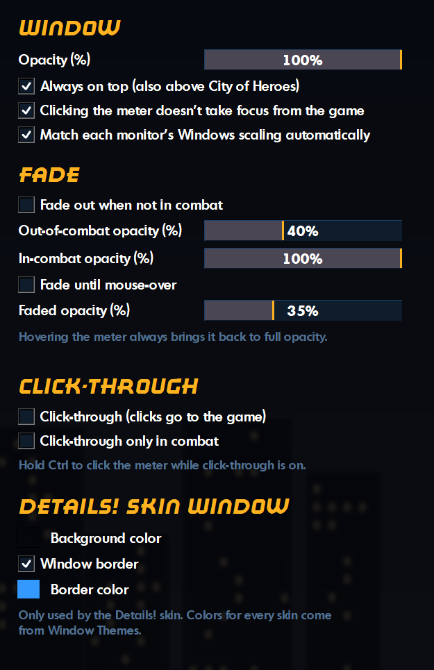

- Click-through sends your clicks to the game. Hold Ctrl to click the meter while it's on.
- Hovering the meter always brings it back to full opacity.

All settings and defaults

| Setting | Default |
|---|---|
| Opacity | 100% |
| Always on top | On |
| Clicking the meter doesn't take focus from the game | On |
| Match each monitor's Windows scaling automatically | On |
| Fade out when not in combat | Off (40% out of combat, 100% in combat) |
| Fade until mouse-over | Off (35%) |
| Click-through | Off |
| Click-through only in combat | Off |

### Profiles

Save a whole setup, window layout included.

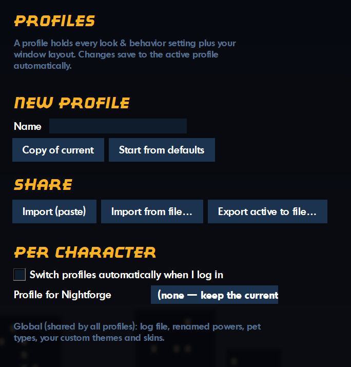

- Make a new profile from your current setup or from defaults.
- Export and import profiles to share them.
- Give each character its own profile and the meter switches when you log in.

### Log files

Which log the meter reads, and log clean-up.

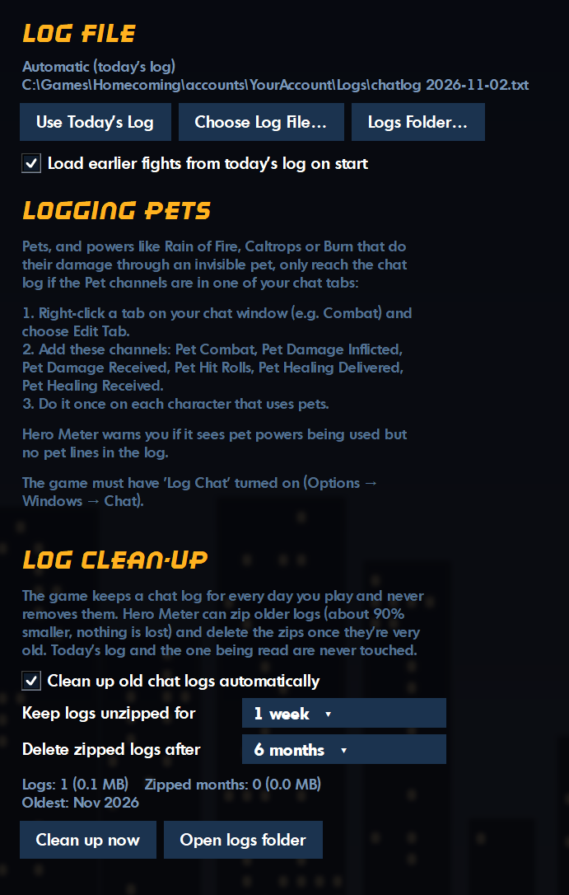

- **Use Today's Log** (the default) follows the newest log on its own.
- Log clean-up zips old logs and deletes very old zips. See [Log clean-up](#log-clean-up) for how it keeps your logs safe.

All settings and defaults

| Setting | Default |
|---|---|
| Log file | Automatic (today's log) |
| Load earlier fights from today's log on start | On |
| Clean up old chat logs automatically | On |
| Keep logs unzipped for | 1 week |
| Delete zipped logs after | 6 months (or Never) |

### Death recap and breakdown

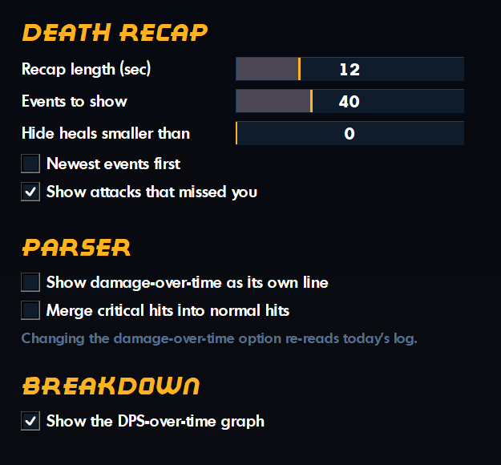

All settings and defaults

| Setting | Default |
|---|---|
| Recap length | 12 sec |
| Events to show | 40 |
| Hide heals smaller than | 0 |
| Newest events first | Off |
| Show attacks that missed you | On |
| Show damage-over-time as its own line | Off |
| Merge critical hits into normal hits | Off |
| Show the DPS-over-time graph | On |

### Builds

Compare a Mids Reborn (`.mbd`) or CoH Sidekick (`.skif`) build with what you actually do.

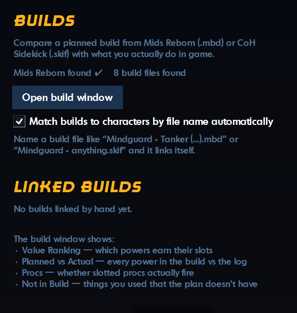

- Name the file after your character, like `Mindguard - anything.mbd`, and it links itself.
- See [Comparing your build](#comparing-your-build) for what the build window shows.

### Rename powers

Rename a power, or merge two by giving them the same name.

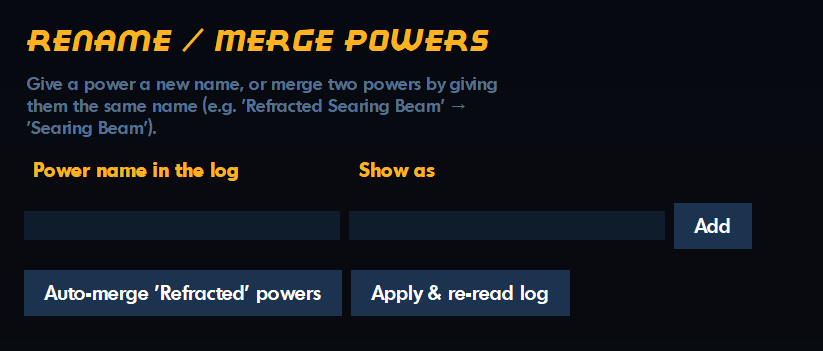

- **Auto-merge 'Refracted' powers** does every Refracted power at once.
- Click **Apply & re-read log** to see the change.

### Window theme editor

Open it from **Window themes → Edit current window theme**.

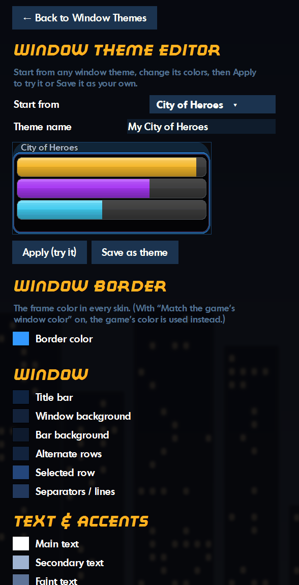

- Start from any theme, change colors, then **Apply** to try it or **Save as theme** to keep it.

### Bar theme editor

Open it from **Bar themes → Edit current bar theme**.

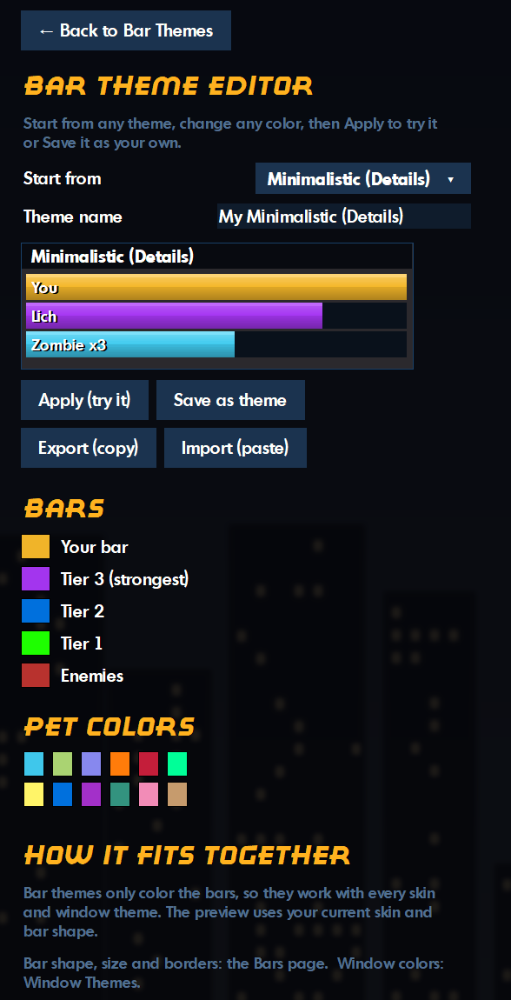

- Same idea as the window editor. **Export** copies a theme to share, and **Import** pastes one in.

---

## Good to know

### Comparing your build

Link a build on the [Builds](#builds) page and the build window shows:

- Value ranking: which powers do the work, and which have lots of slots for little output.
- Planned vs actual: every power in the build and whether you use it.
- Procs: whether your procs fire, and how often.
- Not in build: powers you use that the build doesn't have.

Passive powers like Health and Stamina never show up in the chat log, so "not seen" there is normal.

### Log clean-up

The game keeps a chat log for every day you play, forever. Clean-up keeps that in check without losing anything:

- Logs older than a week are zipped, one zip per month. Nothing is lost, and they take about 90% less space.
- Each zip is checked before the original is removed.
- Zips older than six months are deleted. Set it to **Never** to keep them all.
- Today's log, and the one the meter is reading, are never touched.
- A new zip is never deleted in its first two weeks.

To read an old log, double-click the monthly zip in Explorer.

---

## Troubleshooting

### The meter is empty

- Turn on Log Chat for this character (`/logchat`).
- In the ⚙ menu, make sure **Use today's log automatically** is ticked.

### Pets or Rain of Fire are missing

The pet channels aren't in a chat tab yet. Follow step 3 of [Set up in three steps](#set-up-in-three-steps). Fights before that stay without pet damage.

### Can Hero Meter add the pet channels for me?

No. It would have to type into the game or replace your chat settings, so it's left to you. It's a one-time change per character.

### The window color is wrong

On the [Window themes](#window-themes) page, click **Pick it from a game window** and click a game window border.

### The meter is in the way

Turn on click-through on the [Opacity and fading](#opacity-and-fading) page. Hold Ctrl when you want to click the meter.

### DPS doesn't match another parser

Check **Time measure** on the [General](#general) page. Effective and Active time give different DPS for the same fight.

### I want the old look back

On the [Profiles](#profiles) page, make a new profile with **Start from defaults**.

### Where are my settings?

In `%APPDATA%\Hero Meter`. To keep them next to the exe instead (say, on a USB stick), put an empty file named `portable.txt` beside `HeroMeter.exe`.

### How do I report a bug?

Click **⚙ → About Hero Meter → Copy diagnostics** and paste it into a [new issue](https://github.com/ForgeSprite/HeroMeter/issues/new) with what happened. Account names are blanked out.

---

## Privacy

- Hero Meter only reads files on your PC: chat logs, your character list, the game's fonts and your builds.
- The only files it changes are its own settings and old chat logs, when clean-up is on.
- To match your window color it looks at the game window, only while the game is in front, and keeps just the color.
- Nothing is uploaded. It checks GitHub for updates, and you can turn that off in **⚙ → About Hero Meter**.
